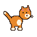
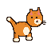
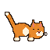
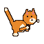
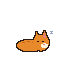

<p align="center">
  
  
  
  
  
</p>

<h1 align="center">Petty</h1>

<p align="center">Пиксельный кот, который живёт на рабочем столе Windows.<br>
Гуляет сам, спит, хочет есть, ест из миски, которую можно наполнить и перетащить, и играет с мячиком по кнопке Play над головой.</p>

## Требования

- Windows 10/11
- .NET SDK 10

## Сборка, тесты, запуск

```powershell
dotnet build Petty.slnx -c Release
dotnet test Petty.slnx
dotnet run --project src/Petty.App
```

Готовый файл — `src/Petty.App/bin/Release/net10.0-windows10.0.19041.0/Petty.exe`.

При первом запуске короткий мастер спросит имя кота и покажет живое превью; при следующих запусках состояние подхватывается само. Значок в трее — единственная точка входа: **Pet settings** переименовывает кота или создаёт нового, **Exit application** проигрывает анимацию ухода и закрывает приложение.
