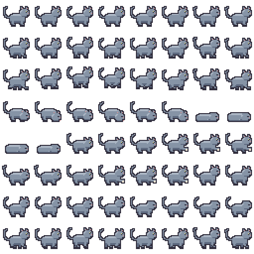

<p align="center">
  
</p>

<h1 align="center">Petty</h1>

<p align="center">Pixel desktop pets for Windows: eight breeds of cats and dogs, five coats per breed.<br>
One active pet that wanders, sleeps, eats from a draggable bowl, plays with a ball and responds to petting.</p>

## Run the portable release

Extract the entire Windows x64 ZIP and start `Petty.exe`; .NET is included. See the
[RU/EN quick start](docs/PORTABLE_README.md), [release details](docs/WINDOWS_RELEASE.md)
and [owner acceptance checklist](docs/RELEASE_CHECKLIST.md). Real OS/desktop acceptance
is still pending; simulated checks are not evidence of actual Explorer/logoff behavior.

## Build from source

- Windows 11 x64 primary; Windows 10 best effort, unverified here.
- .NET SDK 10 (needed only to build).

```powershell
dotnet build Petty.slnx -c Release -m:1
dotnet test Petty.slnx -m:1
dotnet run --project src/Petty.App
```

Build output: `src/Petty.App/bin/Release/net10.0-windows10.0.19041.0/Petty.exe`.

The first-run creator selects species, breed, coat and name with live preview.
Later launches restore the pet without offline needs decay. Right-click the tray
for Settings or animated Exit; closing Settings keeps the pet running. Data stays
in `%LOCALAPPDATA%\Petty`; autostart can be disabled in Settings.

Art is deterministic procedural pixel art; the runtime does not generate assets.
See [architecture](docs/ARCHITECTURE.md) for responsibilities and known shell constraints.
